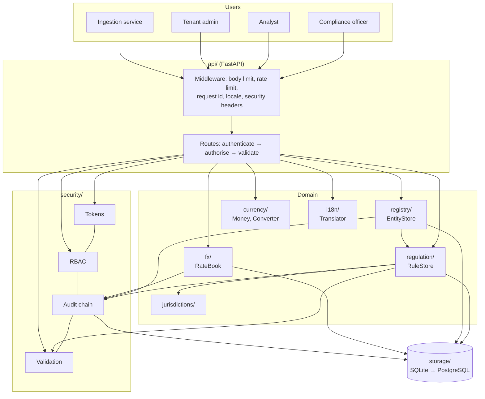

# Architecture

Follows the layered model in the Pitch Pack: *sources → ingestion → knowledge store → services →
API → users*, with security around every layer.

## Dependency rule

Dependencies point **downwards only**. `core` knows nothing; `jurisdictions`, `currency`, `i18n`
and `security` depend on `core`; `regulation` and `fx` use those; `registry` builds on `regulation`
(it maps entities to rules); `api` uses everything; nothing imports `api`. A module that breaks this rule fails review.

| Layer | Modules | May import |
|---|---|---|
| 0 | `core` | stdlib |
| 1 | `jurisdictions`, `currency`, `i18n`, `storage` | layer 0 |
| 2 | `security` | layers 0–1 |
| 3 | `regulation`, `fx` | layers 0–2 |
| 4 | `registry` | layers 0–3 |
| 5 | `api`, `cli`, `config` | all |

## Key design decisions

| # | Decision | Why |
|---|---|---|
| D1 | Rule versions are immutable; approving creates a new state, never an edit | Regulators ask "what applied on date X?" — history must be reproducible |
| D2 | Ingestion can only create a **draft** and a review task | Machine-read law must never silently become "approved" |
| D3 | Approver ≠ proposer (four-eyes), enforced in the store, not only the API | A second API route or script cannot bypass it |
| D4 | Audit entries are written in the same transaction as the change | No change without a record, no record without a change |
| D5 | Audit log is hash-chained per tenant with a published head | Edits and truncation are detectable |
| D6 | Tenant id comes only from the verified token | Request data can never choose whose data is read |
| D7 | `Decimal` end to end; amounts travel as strings | Floating point errors are unacceptable in finance |
| D8 | Rates are tenant-supplied, dated, insert-only | Reproducible conversions; no silent overwrite |
| D9 | Translations are catalogs with fallbacks, rendered with `string.Template.safe_substitute` | No format-string injection |
| D10 | Database triggers enforce immutability as a second line of defence | Protects against bugs in application code |
| D11 | Entities are keyed by LEI and the checksum is verified on input | A mistyped identifier never reaches the data |
| D12 | All periods are inclusive at both ends, `None` = open-ended | One rule everywhere; "ended 31 Dec" means still valid on 31 Dec |
| D13 | Ownership links are insert-only; ending one adds an end date | Past group structures stay reproducible |
| D14 | "Control" is a stated simplification (> 50 % or branch) and the API says so | Honest about what is indicative |
| D15 | Graph walks are depth- and size-capped | A hostile or broken graph cannot exhaust memory |

## Extension points (later phases)

* `storage.Database` → PostgreSQL implementation with the same interface (Phase 4).
* `currency.rates.RateProvider` protocol → live ECB / SNB / MAS feeds (Phase 5).
* `regulation.store.RuleStore.ingest` → EUR-Lex / FINMA / FCA / SEC / MAS connectors (Phase 5, 6).
* New modules (insurance connectivity, exposure graph, stress lab) are added as new packages above `registry`.
